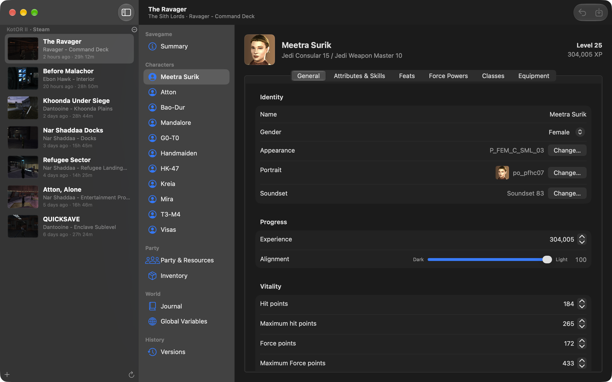

# Kool Save Editor for Macintosh

A native macOS (SwiftUI) savegame editor for *Star Wars: Knights of the Old Republic* and
*The Sith Lords*, named in honor of the Windows [KotOR Savegame Editor (KSE)][kse]. It covers
everything KSE does, with the BioWare file formats implemented in Swift from
[xoreos-tools][xoreos]. Nothing from xoreos or KSE is needed at runtime.

**[Download the latest release](https://github.com/deibele1/kool-save-editor/releases/latest)**
(macOS 14 or later, Apple Silicon and Intel). Open the disk image and drag Kool Save Editor
to Applications.



## Features

- Finds saves automatically in the Mac App Store and Steam locations of both games, including
  TSL Steam Cloud saves; other folders can be added.
- Savegame name, time played, cheat flag.
- Player and companions: name, gender, appearance and portrait (with previews), voice set
  (play a random line; includes the player's voice sets), attributes, skills, experience,
  alignment, hit/Force points, Min 1 HP, feats, Force powers,
  classes (change, add, remove, level), equipment (equip from the game's item blueprints,
  unequip to the inventory).
- Party: credits, party XP, TSL components and chemicals, the active party, and TSL influence
  for every companion.
- Inventory: change quantities, remove, add any item: every blueprint in the game files, the
  override folder and the modules (level files), sortable by type and source,
  copy and paste an inventory between saves.
- Journal: change quest states, add and remove quests.
- Global variables: booleans, numbers and strings.
- Undo/redo for every edit; Xbox `.sig` files are regenerated when present.
- Character sheets say when the game goes on with another copy of the character, which can't
  be edited yet: the player in a TSL transition autosave (`pifo.ifo`), your own character while
  you play as a companion (`pc.utc`), and companions standing in the current area (aboard the
  Ebon Hawk).

### Versions and rollback

Before anything is written, the save folder is copied to
`~/Library/Application Support/KSEMac/Versions` (APFS clones, so copies are nearly free).
Files are then replaced atomically, read back and re-parsed. If a write or the verification
fails, the save is rolled back to that copy automatically. The Versions section lists every
copy and restores any of them (restoring first saves the current state as another version).
Saves changed on disk since they were opened (for example by the game) are detected before
writing: reload the newer save, or replace it as a whole with the one you are editing (the
newer save is kept as a version first).

While a game is running, the editor doesn't save or restore that game's saves: the game keeps
its own copy of the save it loaded and overwrites the slot when it saves. Edit away, then quit
the game and save. Saves the game rewrote are read again when it quits or when you switch back
to the editor; if you have unsaved edits in one, you choose what to keep once the game has quit.

## Game data

Names, icons, and the lists of feats, powers, classes, items and quests come from the game
installation (`chitin.key`, `dialog.tlk`, the override folder and the GUI texture pack). The
app looks in the Steam libraries and `/Applications`; otherwise choose the folder in
**Settings › Games** (for the Mac versions it is inside the app bundle, e.g.
`Contents/Assets` or `Contents/GameData`). Saves can still be edited without it, with numbers
shown instead of names.

Voice samples come from the same installation. *The Sith Lords* ships without the player's
voice sets, so its player character is silent: the editor lists the two the game assigns
(female and male) as silent, and they become audible once a mod restores them.

macOS asks for permission the first time the app reads the Mac App Store containers
(“access data from other apps”).

## Building

Requires Xcode 16 or newer; runs on macOS 14 Sonoma or newer.

```sh
Tools/install-app.sh                       # build a universal Release app into /Applications
open KSEMac.xcodeproj                      # or build and run the KSEMac scheme in Xcode
cd KotORKit && swift test                  # library tests
Tools/release.sh                           # signed, notarized DMG in build/ (maintainers)
```

Layout:

- `KotORKit/Sources/Aurora` – GFF, ERF, KEY/BIF, 2DA, TLK, SSF, TPC/TGA and code pages (from xoreos-tools), and the games' sound containers.
- `KotORKit/Sources/KotORSave` – save loading and editing, game data, discovery, versions and safe writing (from KSE).
- `KSEMac` – the SwiftUI app.
- `Tools/make-icon.swift` – renders the app icon.

## License and disclaimer

The full text is in [`NOTICE`](NOTICE); the license is in [`LICENSE`](LICENSE).

- **Derived from GPL software.** Named in honor of KSE, this program is a Swift translation
  of parts of [KSE][kse] (© tk102, FairStrides and the KSE Team) and [xoreos-tools][xoreos] (the legal
  property of its developers), both licensed under the GNU GPL version 3 or later. As those
  licenses require, this program as a whole is distributed under the same terms.
- **No copyright claimed.** Most of the new code was written by an AI model. The maintainer
  claims no copyright in this program; copyright in the parts derived from KSE and
  xoreos-tools remains with their authors.
- **No warranty, no liability.** This program is provided "as is", without warranty of any
  kind. The maintainer accepts no liability for any damage or loss arising from its use,
  including damaged or lost saved games. Use it at your own risk.
- **Not affiliated.** Star Wars, Knights of the Old Republic and KotOR are trademarks of
  Lucasfilm Ltd. This program is not made, endorsed or supported by Lucasfilm, Disney,
  BioWare, Obsidian Entertainment, Aspyr Media, the KSE team or the xoreos project, and
  contains no game files.

[kse]: https://gitlab.com/kotorsge-team/kse
[xoreos]: https://github.com/xoreos/xoreos-tools
